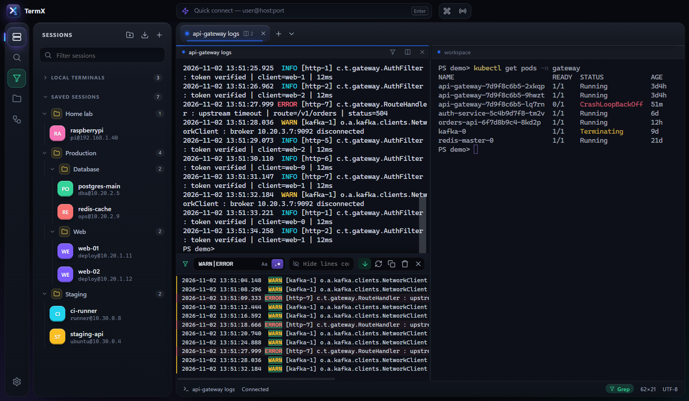
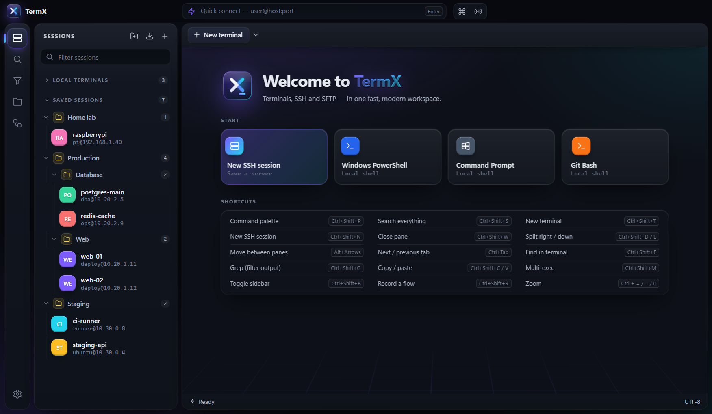
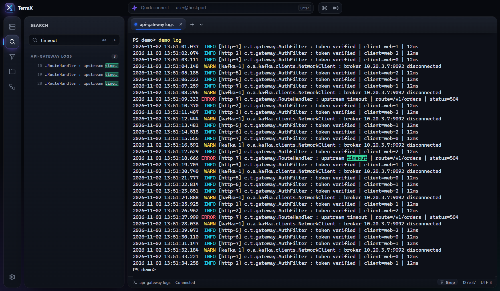
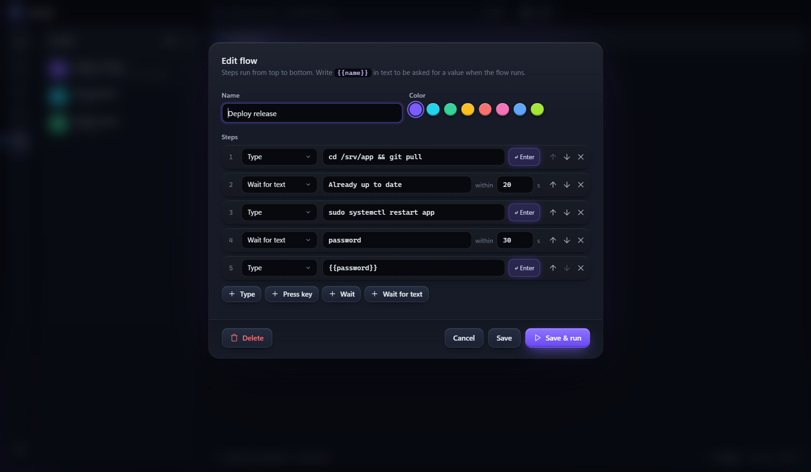
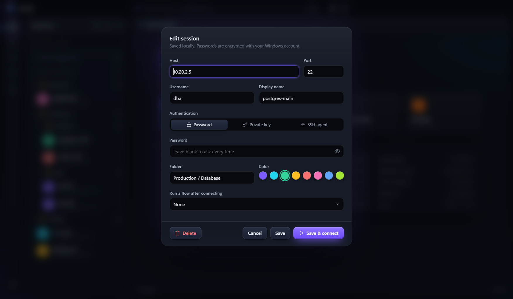

<div align="center">


# TermX

**A modern terminal, SSH and SFTP workspace for Windows, macOS and Linux.**

Local shells, saved SSH sessions in folders, a drag-and-drop file browser, split panes, a Grep Console-style log filter and recorded macros, all in one fast, clean app.

[](https://github.com/Shakeel-Hasssan/TermX/releases/latest)
[](https://github.com/Shakeel-Hasssan/TermX/actions/workflows/release.yml)

[](LICENSE)

[**Download**](#download) · [Features](#features) · [How to use](#how-to-use) · [Shortcuts](#keyboard-shortcuts) · [Build from source](#build-from-source)



</div>

## Why TermX?

If you live in terminals all day (tailing logs, jumping between servers, moving files around), you usually juggle a terminal, an SSH client, an SFTP tool and a text editor. TermX puts them in one window, inspired by MobaXterm, with a modern UI and features built for reading logs.

- **Bring your sessions with you.** Import connections from MobaXterm, PuTTY or your OpenSSH config in a couple of clicks, folders included.
- **Find the line that matters.** Filter a live log down to `WARN|ERROR` with Grep, or search every open terminal at once.
- **Stop retyping things.** Record what you type once as a *Flow* and replay it on any server.

## Download

Get the latest version from the **[Releases page](https://github.com/Shakeel-Hasssan/TermX/releases/latest)**.

| Platform | File to download |
|---|---|
| **Windows** 10/11 (installer) | `TermX-<version>-win-x64.exe` |
| **Windows** (portable, no install) | `TermX-<version>-win-portable.exe` |
| **macOS**, Apple silicon (M1 and later) | `TermX-<version>-mac-arm64.dmg` |
| **macOS**, Intel | `TermX-<version>-mac-x64.dmg` |
| **Linux**, any distro | `TermX-<version>-linux-x86_64.AppImage` |
| **Linux**, Debian or Ubuntu | `TermX-<version>-linux-amd64.deb` |

### System requirements

The installers include everything TermX needs. You don't need Node.js, npm or Git to use it; those are only for [building from source](#build-from-source).

| Platform | Requirement |
|---|---|
| **Windows** | Windows 10 or 11, 64-bit |
| **macOS** | macOS 12 Monterey or newer (pick the Apple silicon or Intel download to match your Mac) |
| **Linux** | 64-bit (x86_64) on a current distro, such as Ubuntu 20.04+, Debian 11+ or Fedora |
| **Disk space** | About 300 MB |

Only needed for some features:

- **AppImage on Ubuntu 22.04 and newer** needs FUSE, which isn't installed by default: `sudo apt install libfuse2` (on Ubuntu 24.04 the package is `libfuse2t64`). The `.deb` doesn't need it.
- **Remembering passwords on Linux** needs a keyring such as GNOME Keyring or KWallet (most desktops include one). Without it, TermX asks for the password each time.
- **"SSH agent" sign-in** needs an agent running. On Windows, start the *OpenSSH Authentication Agent* service. Password and key sign-in work without it.
- **Git Bash and WSL** appear as shells only if they're installed. PowerShell and CMD are always available on Windows.
- **Live server stats** (CPU, RAM, disk, uptime) are shown for Linux servers.

### First launch

TermX isn't code-signed yet, so each system asks you to confirm the first time you open it:

- **Windows:** if SmartScreen says *"Windows protected your PC"*, click **More info**, then **Run anyway**.
- **macOS:** open the `.dmg` and drag TermX to **Applications**. The first time, right-click TermX in Applications and choose **Open**, then **Open** again. If macOS says the app *"is damaged"*, run this once in Terminal:
  ```bash
  xattr -cr /Applications/TermX.app
  ```
- **Linux (AppImage):** make it executable, then run it:
  ```bash
  chmod +x TermX-*.AppImage && ./TermX-*.AppImage
  ```
- **Linux (.deb):**
  ```bash
  sudo apt install ./TermX-*.deb
  ```

## Features

<table>
<tr>
<td width="50%" valign="top">

### Terminals
- Local shells detected automatically: PowerShell 7, Windows PowerShell, CMD, Git Bash and WSL on Windows; your login shell on macOS and Linux.
- **Split panes** right or down, as many as you like; drag dividers to resize.
- Tabs you can rename and reorder, truecolor and a GPU (WebGL) renderer.
- **Multi-exec** types into every connected pane at once.
- 6 themes, plus font, cursor and selection colors.

</td>
<td width="50%" valign="top">

### SSH and SFTP
- Password, private key or SSH agent sign-in, with host keys verified on first use.
- **Saved sessions in nested folders** you can rename, drag and drop, and connect all at once.
- **Import** from MobaXterm, PuTTY, OpenSSH config or a TermX export.
- **SFTP browser** that follows the active tab: drag-and-drop upload, download, rename, delete, and edit-in-place (saves upload automatically).
- Live CPU, RAM, disk and uptime for Linux servers.

</td>
</tr>
<tr>
<td valign="top">

### Logs
- **Grep** (like IntelliJ's Grep Console): show lines matching some text and hide others, with regex and live follow. **Refresh** re-runs the filter over everything.
- **Search** the scrollback of every open terminal, plus your sessions and flows.
- ERROR and WARN lines are color-coded; click any result to jump to it.

</td>
<td valign="top">

### Automation
- **Flows** (like MobaXterm macros): record your typing or build steps by hand: *Type*, *Press key*, *Wait*, *Wait for text*.
- `{{name}}` placeholders ask for a value when the flow runs.
- Run a flow in one pane, a whole tab, or every connected terminal, or automatically after a session connects.

</td>
</tr>
</table>

<table>
<tr>
<td width="50%"></td>
<td width="50%"></td>
</tr>
<tr>
<td align="center"><sub>Start page</sub></td>
<td align="center"><sub>Search across every open terminal</sub></td>
</tr>
<tr>
<td width="50%"></td>
<td width="50%"></td>
</tr>
<tr>
<td align="center"><sub>Flows: replay what you type</sub></td>
<td align="center"><sub>Saved sessions</sub></td>
</tr>
</table>

## How to use

### Connect to a server
- **Quick connect:** type `user@host` or `user@host:2222` in the bar at the top and press Enter. You can paste a whole `ssh user@host -p 2222` command too.
- **Save a session:** click **+** in the Sessions panel (or press `Ctrl+Shift+N`), fill in the host, user and sign-in method, then **Save & connect**. Saved passwords are encrypted with your OS account (Windows DPAPI, macOS Keychain, or the Linux keyring).
- **Import existing sessions:** click the import icon in the Sessions panel. TermX finds MobaXterm and PuTTY sessions and `~/.ssh/config` automatically, or you can pick an exported file (`.mxtsessions`, `.reg`, ssh config or TermX `.json`). Imported sessions ask for their password on first connect and can remember it.

### Organize sessions
- Right-click a folder (or hover it and click **⋯**) to create subfolders, rename, delete, add a session or **Connect all**.
- Drag sessions and folders onto a folder to move them; drop on **Saved sessions** for the top level.
- Type a path such as `Production / Database` in a session's Folder field to create nested folders.

### Work with files (SFTP)
Open the folder icon in the left bar while an SSH tab is active. Drag files or folders in to upload, right-click to download, rename or delete, and double-click a file to edit it in your default app; every save uploads it again.

### Filter logs with Grep
Press `Ctrl+Shift+G` (or click **Grep** in the status bar) under a terminal that's tailing a log:
1. Type text in **Show lines containing…**, or turn on `.*` for a regex such as `WARN|ERROR`.
2. Use **Hide lines containing…** to drop noise.
3. New lines are filtered live. **Refresh** re-runs the filter over everything, **Clear** shows only new output, and clicking a line jumps to it in the terminal.

### Record a Flow
Press `Ctrl+Shift+R`, type your commands as usual, and press `Ctrl+Shift+R` again to save them as a flow. Edit the steps, add *Wait for text* (for example, wait for `password:`), and replay it from the Flows panel, the command palette, or automatically when a session connects.

### Split and multi-exec
`Ctrl+Shift+D` splits right and `Ctrl+Shift+E` splits down. Move between panes with `Alt+Arrow keys`. Turn on **Multi-exec** (`Ctrl+Shift+M`) to type into every connected pane at once.

## Keyboard shortcuts

On macOS these use **Ctrl** too, not Cmd.

| Action | Keys |
|---|---|
| Command palette | `Ctrl+Shift+P` |
| New terminal / new SSH session | `Ctrl+Shift+T` / `Ctrl+Shift+N` |
| Split right / down | `Ctrl+Shift+D` / `Ctrl+Shift+E` |
| Move between panes | `Alt+Arrow keys` |
| Close pane | `Ctrl+Shift+W` |
| Next / previous tab | `Ctrl+Tab` / `Ctrl+Shift+Tab`, `Alt+1…9` |
| Copy / paste | `Ctrl+Shift+C` / `Ctrl+Shift+V` |
| Find in terminal | `Ctrl+Shift+F` |
| Search everything | `Ctrl+Shift+S` |
| Grep (filter output) | `Ctrl+Shift+G` |
| Multi-exec | `Ctrl+Shift+M` |
| Record / stop recording a flow | `Ctrl+Shift+R` |
| Toggle sidebar | `Ctrl+Shift+B` |
| Zoom in / out / reset | `Ctrl+=` / `Ctrl+-` / `Ctrl+0` |

## Your data

Everything stays on your computer. Nothing is sent anywhere except the servers you connect to.

| | Location |
|---|---|
| Windows | `%APPDATA%\TermX` |
| macOS | `~/Library/Application Support/TermX` |
| Linux | `~/.config/TermX` |

It holds `sessions.json`, `folders.json`, `flows.json` and `known_hosts.json`. Passwords are stored encrypted with your OS account. On Linux without a keyring (for example a bare window manager), TermX doesn't save passwords and asks each time. **Export** (in the import dialog) writes your sessions to a JSON file without passwords.

## Build from source

You need [Node.js](https://nodejs.org) 20 or later and Git.

```bash
git clone https://github.com/Shakeel-Hasssan/TermX.git
cd TermX
npm install
npm start
```

npm 11 skips install scripts by default. If `npm start` says Electron failed to install, run this once:

```bash
node node_modules/electron/install.js
```

To build installers for your own platform (they land in `dist/`):

```bash
npm run dist
```

### Releasing a new version

1. Update `version` in `package.json` (for example, to `0.2.0`) and commit.
2. Tag and push:
   ```bash
   git tag v0.2.0
   git push origin main v0.2.0
   ```
3. GitHub Actions builds Windows, macOS and Linux installers and attaches them to a new [release](https://github.com/Shakeel-Hasssan/TermX/releases). It takes about 10 minutes.

## Project layout

```
src/
  main.js         main process: shells (node-pty), SSH and SFTP (ssh2), storage, host keys
  importers.js    MobaXterm, PuTTY, OpenSSH and TermX session import
  preload.js      safe bridge between the UI and the main process
  renderer/       the UI: app.js, styles.css, themes.js, icons.js
  assets/         app icon (SVG master, PNG, ICO)
.github/workflows/release.yml   builds and publishes installers on version tags
```

Built with [Electron](https://www.electronjs.org), [xterm.js](https://xtermjs.org), [node-pty](https://github.com/microsoft/node-pty) and [ssh2](https://github.com/mscdex/ssh2).

## Contributing

Bug reports and ideas are welcome. Please [open an issue](https://github.com/Shakeel-Hasssan/TermX/issues/new/choose) using one of the templates. For code changes, fork the repo, create a branch, and open a pull request with a short description and screenshots for UI changes.

## License

[MIT](LICENSE) © Shakeel Hassan
